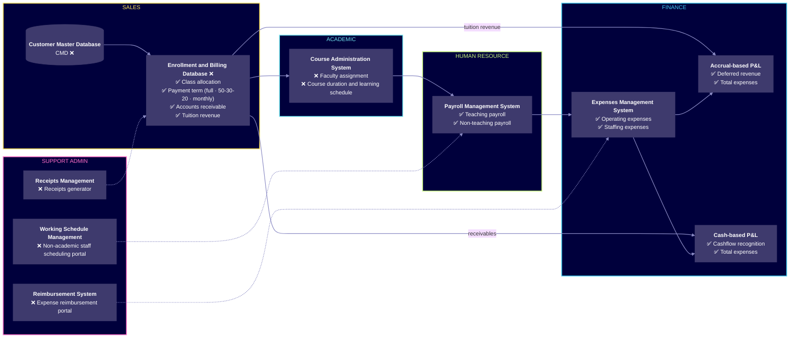

<!--
  ════════════════════════════════════════════════════════════════════
  PROJECT README · Daxton Huynh — Business Portfolio
  Ghi chú trong các comment <!-- … --> như thế này KHÔNG hiển thị trên GitHub.
  Đặt file này tại: business-portfolio/zero-cost-operations-system/README.md
  ════════════════════════════════════════════════════════════════════
-->

  

  
  
  

  <a href="#overview">Overview</a> ·
  <a href="#challenges">Challenges</a> ·
  <a href="#business-values">Business values</a> ·
  <a href="#excel-based-operation-systems">The system</a> ·
  <a href="#inside-the-system">Screenshots</a> ·
  <a href="#other-projects">Other projects</a>

---

## Overview

AMI Education was founded in March 2024 to bridge the gap in access to high-quality English education in Bac Lieu, a rural province in Vietnam. As the company grew, it faced the challenge of **scaling operations with extremely limited resources**.

With **no budget** for expensive ERP, CRM, or accounting systems, and **no headcount** for specialized staff, the company needed a **zero-cost, Excel-based solution** to automate workflows across **Sales, Academic, HR, and Finance**.

| | |
|---|---|
| **Organization** | AMI Education — English-education startup, Bac Lieu, Vietnam |
| **Timeline** | Mar 2024 – Aug 2024 |
| **My role** | Co-founder & CEO · designed and built the system |
| **Scope** | Sales · Academic · Human Resource · Finance · Support Admin |
| **Tools** | Microsoft Excel <!-- Thêm công cụ cụ thể đã dùng: Power Query, VBA, Data Validation, Google Forms… --> |
| **Software budget** | Zero — no paid systems, no additional headcount |

---

## Challenges

<table>
<tr>
<td width="33%" valign="top">

### Limited resources
As an early-stage startup, AMI could not afford to hire specialized staff. Some employees had to **wear various hats**, making workload reduction essential.

</td>
<td width="33%" valign="top">

### No budget for professional systems
ERP, CRM, and class management tools in Vietnam are **prohibitively expensive** for a small education business.

</td>
<td width="33%" valign="top">

### Fragmented data flows
Manual duplication of data across teams (Sales, Academic, HR, Finance) **consumed time and effort** and created **room for errors**. A single update had to be repeated in multiple places instead of cascading automatically into class assignments, receivables, payroll, and P&L reporting.

</td>
</tr>
</table>

---

## Business values

  

| Metric | Result | How |
|---|:---:|---|
| Administrative workload | **↓ 70%** | A zero-cost, Excel-based information system that integrates all business functions |
| Monthly staffing expenses | **↓ 10%** | Real-time, automated reporting of operational data, reducing redundant tasks and optimizing resources across departments |

---

## Excel-based operation systems

- Built **integrated Excel-based systems** covering Sales, Academic, HR, and Finance, enabling **centralized data management and automation**.
- Streamlined operations with **single-input workflows**, automated revenue recognition, payroll, and **dynamic P&L reporting**.

> **Legend** &nbsp; ✅ Automatically updated &nbsp;·&nbsp; ❌ Manual input &nbsp;·&nbsp; dashed arrow = support input

<!-- Sơ đồ được dựng lại từ trang 3 của portfolio. Vui lòng kiểm tra lại các mũi tên cho đúng luồng dữ liệu thực tế. -->

### Module map

| Department | System | Components | Input |
|---|---|---|:---:|
| 🟨 **Sales** | Customer Master Database (CMD) | Customer records | ❌ |
| | Enrollment & Billing Database (EBD) | Class allocation · Payment term (full package, 50-30-20, monthly) · Accounts receivable · Tuition revenue | ❌ → ✅ |
| 🟦 **Academic** | Course Administration System | Faculty assignment · Course duration & learning schedule | ❌ |
| 🟩 **Human Resource** | Payroll Management System | Teaching payroll · Non-teaching payroll | ✅ |
| 🔷 **Finance** | Expenses Management System | Operating expenses · Staffing expenses | ✅ |
| | Accrual-based P&L | Deferred revenue · Total expenses | ✅ |
| | Cash-based P&L | Cashflow recognition · Total expenses | ✅ |
| 🟪 **Support Admin** | Receipts Management | Receipts generator | ❌ |
| | Working Schedule Management System | Non-academic staff scheduling portal | ❌ |
| | Reimbursement System | Expense reimbursement portal | ❌ |

### How a single input cascades

<!-- Mô tả dưới đây suy ra từ sơ đồ trong portfolio — chỉnh lại cho khớp cách hệ thống thực sự vận hành. -->

1. **Enroll once.** Sales records a student in the CMD and an enrollment in the EBD — class allocation, the payment schedule, receivables, and tuition revenue update automatically.
2. **Teach, then pay.** Academic sets faculty assignments and learning schedules, which feed the payroll system; non-academic schedules arrive from the Support Admin portal.
3. **Close the books automatically.** Payroll and reimbursements roll into the Expenses Management System, which feeds both the **accrual-based P&L** (deferred revenue) and the **cash-based P&L** (cashflow recognition).

---

## Inside the system

<!--
  ⚠️ Ẩn danh hoá dữ liệu trước khi đưa lên public: tên học viên, số điện thoại,
  học phí từng người, lương nhân sự. Xuất ảnh khoảng 1600px chiều ngang, lưu vào assets/.
-->

<table>
<tr>
<td width="50%" align="center">
   
  <b>Sales Pipeline Dashboard</b> — executive summary and KPI indicators
</td>
<td width="50%" align="center">
   
  <b>Enrollment & Billing Database</b> — single-input sheet that drives downstream modules
</td>
</tr>
</table>

---

## Skills demonstrated

| Skill | Evidence |
|---|---|
| **Information system design** | Mapped Sales, Academic, HR, Finance, and Support Admin into one integrated data model with single-input workflows |
| **Workflow automation** | Automated revenue recognition, payroll, and dynamic P&L reporting |
| **Resource optimization** | Cut administrative workload by 70% and saved 10% of monthly staffing expenses |

---

## Other projects

<table>
<tr>
<td width="50%" valign="top">

JUN 2024 – JUN 2025 · AMI EDUCATION
### #GO2025 Initiative — Zero-Cost Strategy
☑ Leadership &nbsp; ☑ Operational management &nbsp; ☑ Strategy planning and execution

</td>
<td width="50%" valign="top">

JAN 2023 – DEC 2023 · SIEMENS
### Sustainability @Siemens Vietnam
☑ Leadership &nbsp; ☑ Stakeholder engagement &nbsp; ☑ Market research

</td>
</tr>
<tr>
<td width="50%" valign="top">

OCT 2023 – JUL 2024 · SIEMENS
### Go Digital! B2B Distributors
☑ Partnership management &nbsp; ☑ Content management application (CMA)

</td>
<td width="50%" valign="top">

SEP 2022 – DEC 2022 · SIEMENS
### Xcelerator Pitch Competition
☑ Leadership &nbsp; ☑ Innovation and development

</td>
</tr>
</table>

---

<h2 align="center">Thank you for your time!</h2>

  <!-- Thay YOUR-LINKEDIN-ID bằng đường dẫn LinkedIn thật -->
  
  
  

<a href="../README.md">← Back to portfolio</a>

